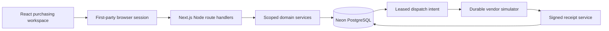

# ProcureDesk

A purchasing workspace that connects employee requests, budget-safe approvals, purchase orders, and simulated receipts.

[Native application URL](https://procuredesk-xi.vercel.app) · [Source](https://github.com/nirajmohabey/procuredesk) · [Native hosting and verification status](docs/NATIVE_VERCEL.md) · [Operator handoff](docs/OPERATOR_HANDOFF.md)

**Current source:** native Next.js App Router on the Node.js runtime, with Neon PostgreSQL and a first-party browser-private demo session. The Vercel application serves its own interface and API; it does not redirect visitors to Sites or require ChatGPT, Google, or another external account. **Native deployment promotion and hosted acceptance are pending verification.** The release receipt must identify the verified commit and deployment before these are marked complete.

Opening the application creates an isolated demo workspace for that browser. A signed, HttpOnly cookie retains access for 30 days. Another browser has a separate workspace; clearing the site's cookies or allowing access to expire loses access to the previous demo workspace. The four selectable personas are fictional roles within that workspace, not real colleagues or company accounts.

The new PostgreSQL deployment starts with fresh sample data. Existing Sites/D1 workspaces remain on the historical Sites deployment; there is no silent identity or data migration.

## Run locally

Requires Node.js 24 or newer, npm, Git, and a dedicated PostgreSQL database. Configure `DATABASE_URL`, optional migration connection `DATABASE_URL_UNPOOLED`, and `SESSION_SECRET` in an ignored `.env.local`. Keep their values out of source. See [native setup](docs/NATIVE_VERCEL.md) for the environment contract.

```sh
npm ci --no-audit --no-fund
node scripts/migrate-postgres.mjs
npm run dev
```

Open the loopback URL printed by Next.js. There is no external sign-in step. The first workspace request seeds fictional organizations and purchasing records after the schema migration has been applied. Stop the server with Ctrl+C.

```sh
npm run typecheck
npm run build
npm start
```

The database migration is an explicit maintainer operation before promotion. Request handlers do not create or alter tables. `scripts/migrate-postgres.mjs` applies versioned `postgres/*.sql`, records their hashes, and refuses changed applied migrations. The legacy `db:migrate` command targets the old local D1 store; use the PostgreSQL script for this native deployment.

## Try the workflow

1. Select Maya, create an equipment request, save it, and submit. Submission freezes the commercial details.
2. Select Alex, open the request, inspect the department's available funds, and approve. The amount becomes reserved and one purchase order is created.
3. Open Purchase orders. **Dispatch next order** handles one eligible queued job, oldest first. An older seeded order may be processed first; inspect the matching purchase-order number and queue state.
4. Simulate the intended order's receipt. Reserved funds become spent; available funds remain unchanged by fulfillment. Inspect its timeline and budget ledger.
5. Run Reliability lab as Alex or Niraj. Jordan is read-only finance; only the Niraj administrator persona can reset the selected demonstration organization.

**Queue for dispatch** requeues a stopped job but does not send it. After the queue action, use **Dispatch next order** separately. An active lease must expire before requeue. See the [operator handoff](docs/OPERATOR_HANDOFF.md) for recovery and escalation.

## Accounting and authorization

- Currency is integer USD cents. Available = limit - reserved - spent.
- Approval commits a budget reservation, purchase order, audit event, and outbox intent together.
- PostgreSQL budget-row locking and constraints protect competing approvals; these require native PostgreSQL verification, not an inference from old SQLite results.
- A valid signed receipt moves funds from reserved to spent once. Duplicate receipts and late dispatch acknowledgements must preserve terminal state.
- Only the requester edits or submits a draft. Submitted values are immutable. No persona can approve or reject its own request.
- The server verifies the browser session and organization/persona permissions. Client roles and balances do not grant authority.
- Idempotency keys bind an operation to its validated inputs; changed input under the same scoped key conflicts.

## Current architecture



The native `pg` adapter executes each domain batch on one PostgreSQL connection from BEGIN through COMMIT or ROLLBACK. PostgreSQL migrations define its tables, accounting triggers, row locks, and constraints. Zod validates input. The purchasing interface, operation keys, leased outbox, and simulator boundaries are retained from the earlier product.

## Verification and historical evidence

Native build, session isolation, PostgreSQL concurrency/recovery, hosted browser workflow, and production-alias checks must have their own dated results and commit references. Their current publication status is tracked in [NATIVE_VERCEL.md](docs/NATIVE_VERCEL.md). A configured test or deployment is not an executed result.

The original [verification report](docs/VERIFICATION.md) and [purchasing pilot](docs/PURCHASING_PILOT.md) are **historical Sites/D1 release evidence**. The recorded 16-test SQLite suite, its 25 independent-connection race fixtures, five hosted lab checks, and simulated pilot observations are not relabeled as native PostgreSQL or new Vercel results. The pilot was an internal AI-assisted exercise with fictional personas; no independent customer participation, paid client work, or business savings are claimed.

The retained `npm test` SQLite suite supplies compatibility evidence. The separate PostgreSQL suite is `tests/postgres.integration.test.mjs`; its execution and database environment must be recorded separately. Passing SQLite checks cannot establish PostgreSQL locking behavior or hosted performance.

## Scope

This is a portfolio sandbox with persistent records and a simulated supplier. No real purchase, payment, supplier message, or automatic fulfillment occurs. Both sides of the durable simulator use the application database. Dispatch is operator-triggered, not an autonomous worker daemon.

One item per request; USD only; seeded November 2026 monthly budgets; whole-order receipts. Refunds, approved-order cancellation, tax calculation, multi-stage approvals, attachments, real company membership provisioning, and external supplier integration are outside this release. No production compliance, customer adoption, throughput benchmark, availability SLA, or tested backup restoration is claimed.

## Source map

| Location | Responsibility |
| --- | --- |
| `app/` | Purchasing UI and native Next.js HTTP routes |
| `src/server/http.ts`, `src/server/session.ts` | Browser owner session and HTTP boundary |
| `src/server/service.ts`, `src/server/postgres.ts` | Domain operations and native PostgreSQL adapter |
| `postgres/`, `scripts/migrate-postgres.mjs` | Explicit, versioned PostgreSQL migrations |
| `tests/postgres*.mjs`, `tests/session.test.mjs` | Native database and browser-session acceptance checks |
| `docs/` | Current operating handoff and separately labeled historical evidence |
| `vite.config.ts`, `worker/`, `drizzle/`, `.openai/` | Retained legacy Sites/D1 implementation assets |

The optional `dev:sites`, `build:sites`, and `start:sites` scripts retain legacy tooling for reference. The current source's HTTP/session boundary is native Node/PostgreSQL; those script names alone do not establish a working dual-runtime release. The old Sites deployment remains a separate historical application.
