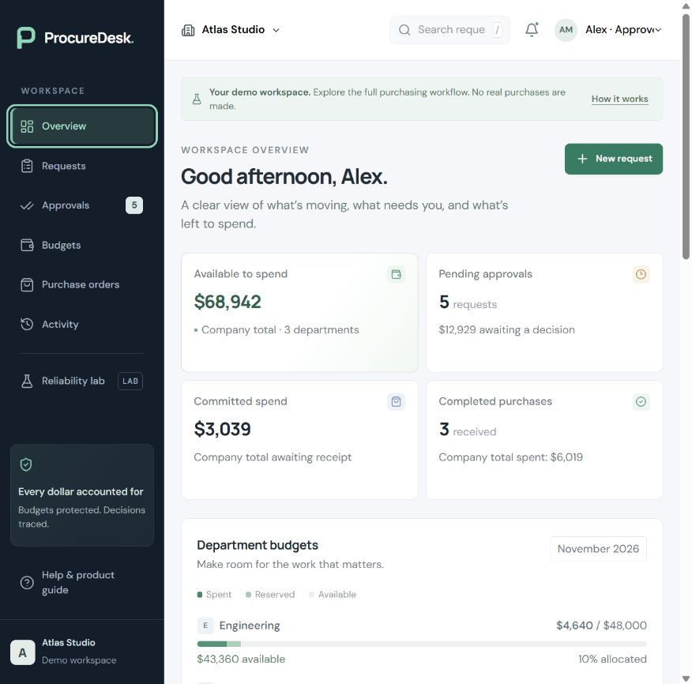
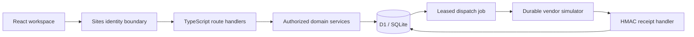

# ProcureDesk

A purchasing workspace that keeps the budget correct when approvals compete and delivery events repeat.

[Open the live demo](https://procuredesk-niraj.flowerycider4.chatgpt.site) · [Source repository](https://github.com/nirajmohabey/procuredesk) · [Verification evidence](docs/VERIFICATION.md)

The public demo uses ChatGPT sign-in to create an isolated workspace for each visitor.

[Purchasing pilot record](docs/PURCHASING_PILOT.md) · [Operator handoff](docs/OPERATOR_HANDOFF.md)

[Vercel entry hosting](docs/VERCEL_ENTRY.md): the Vercel project forwards visitors to the canonical Sites/D1 application.

The pilot record is an internal, AI-assisted simulated stakeholder exercise. Independent customer participation and business savings are not claimed.



Create a request, submit it, switch to an approver, reserve its budget, dispatch a simulated order, and record its receipt. Every decision has a readable audit trail. A built-in Reliability lab exercises the same backend services against an isolated fixture.

## Run locally

Requires Node.js 24 or newer, npm, and Git. No Docker or external database account is required.

```sh
npm ci --no-audit --no-fund
npm run build
npm run db:migrate
npm run dev
```

Open the loopback URL printed by the development server. Use the app's **Sign in with ChatGPT** link; on loopback development only, the starter supplies a local test identity. The production build excludes that adapter. The first authenticated workspace visit seeds the demo records in the migrated database. Stop the server with Ctrl+C.

```sh
npm run typecheck
npm test
```

`npm run db:migrate` applies only pending local migrations. Local data lives under ignored `.wrangler/state`. Hosted data is separate. Start development with `npm run dev` after initial setup; rebuilding and migrating is necessary only when the corresponding source or schema changes.

## Two-minute walkthrough

1. Explore Overview, Requests, Approvals, Budgets, Purchase orders, and Activity as Alex, the approver.
2. Select Maya, the employee. Create an equipment request and submit it. Submission freezes its commercial details.
3. Select Alex. Open the request, review the available department budget, and approve. The amount becomes reserved immediately.
4. Open Purchase orders. Dispatch the simulated order, then record its receipt. Reserved funds become spent; available funds stay unchanged by fulfillment.
5. Open Reliability lab and run its checks. Inspect the competing USD 70 approvals against a USD 100 budget, dispatch recovery, receipt deduplication, and access checks.

The persona switcher is a product demonstration inside your own authenticated sandbox. It does not impersonate other real accounts. Each authenticated Site user owns an independent sandbox; Atlas and Nova are distinct demo organizations within it. Jordan is read-only finance. Admin can manage the demo and approve other people's requests. No persona can approve its own request.

## Accounting rules

- All money is integer USD cents. Available = limit - reserved - spent.
- Approval atomically reserves funds and creates one internal order, audit event, and outbox job.
- A signed receipt atomically transfers the amount from reserved to spent once.
- Drafts can be edited by their owner. Submitted and approved amounts are immutable.
- Client roles and totals are never authoritative. Server permission checks and tenant-scoped database constraints protect mutations.
- Idempotency keys bind a mutation to its validated inputs. Changed input under the same scoped key returns a conflict.

## Architecture



The web runtime is Vinext with Next.js App Router APIs, React, and TypeScript. Zod validates input. Drizzle declares the SQLite schema; SQL triggers implement critical accounting transitions. Cloudflare D1 runs the hosted database. Tests execute the actual service and migrations against real SQLite files, including independent connection races. Source and lockfile are included.

## Scope and release boundaries

This is a hosted portfolio sandbox, with real persistence and authentication and a simulated supplier. It never sends a real purchase or payment. Dispatch is explicitly operator-triggered; it is not a continuously running background daemon. Delivery remains pending until dispatched or retried. The deliberate crash mode leaves a leased job for recovery.

The supplied handbook describes PostgreSQL, Docker, a separate worker, and AWS. This implementation adapts deployment to Sites/Cloudflare D1 and a request-driven dispatcher. It preserves the purchasing workflow and accounting invariants, but SQLite race results do not establish PostgreSQL row-lock behavior. See [architecture and operating notes](docs/ARCHITECTURE.md) and [verification evidence](docs/VERIFICATION.md).

One item per request; USD only; whole-order receipts. No refunds, cancellation after approval, tax engine, multi-stage approval, attachments, live vendor integration, membership administration, or claims of production compliance. Production organizational use would require real membership provisioning, an autonomous dispatcher, backup/restore drills, operational monitoring, and an external supplier contract.

## Source map

| Location | Responsibility |
| --- | --- |
| `app/` | Workspace UI and HTTP routes |
| `src/server/` | Authorization, mutations, receipts, simulator, reliability lab |
| `db/schema.ts`, `drizzle/` | Database model and versioned migrations |
| `tests/` | Real-database integration and concurrency checks |
| `docs/` | Decisions, operating notes, measured verification |
| `.openai/hosting.json` | Site identity and database binding, no secrets |

Hosted publication uses the Sites workflow. The tracked Site ID belongs to this deployment; do not reuse it for an independent fork. Credentials are never part of source or deliverables.

For an independent fork, remove the `project_id` from `.openai/hosting.json` before registering a new Site. Keep the `d1` database binding. Local development needs no Site registration.
